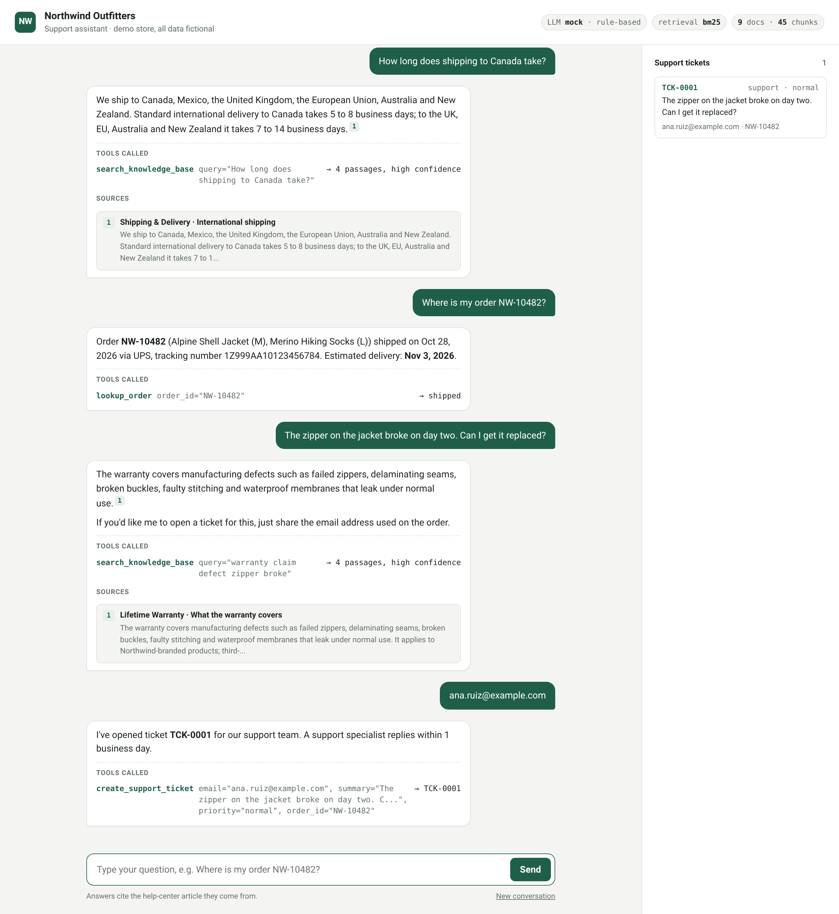
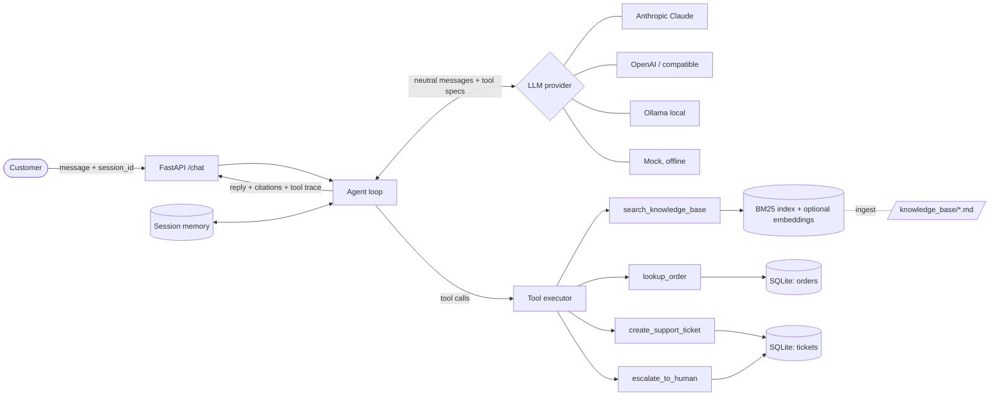

# support-agent-rag

**An AI customer-support agent that answers from your help center, checks real order data, opens tickets, and hands off to a human when it isn't sure.**

Built with Python 3.12, FastAPI and a provider-agnostic tool-calling loop (Anthropic Claude, OpenAI, or a local model through Ollama). It runs fully offline with a deterministic mock model, so you can clone it and see it work in under a minute without an API key.



> The demo store, **Northwind Outfitters**, is fictional. All policies, orders and customers are made up.

---

## The problem

Most support inboxes get the same 20 questions over and over: *Where is my order? Can I return this? Is this covered by warranty? Which size should I get?* Agents spend hours copy-pasting help-center articles and looking up tracking numbers. A plain chatbot doesn't fix this: it either can't answer, or it confidently makes up a return policy that doesn't exist.

## The solution

A support agent that behaves like a careful new hire:

| It... | How |
|---|---|
| **Answers from your documentation only** | Retrieval-augmented generation (RAG) over your help-center articles. Every factual sentence carries a citation to the article section it came from. |
| **Looks up live data** | Tool calling: `lookup_order(order_id)` reads status, carrier, tracking and ETA from the order system. |
| **Takes action** | `create_support_ticket(email, summary)` opens a ticket with the order linked and the conversation id attached. |
| **Knows when to stop** | If retrieval confidence is low, or the customer asks for a person, it calls `escalate_to_human` instead of guessing. |
| **Remembers the conversation** | Per-session memory, so "my email is ..." three messages later still lands on the right ticket and order. |

## Features

- **Hybrid retrieval, no key required.** BM25 (`rank_bm25`) with section-aware markdown chunking, light stemming and domain synonyms. If `OPENAI_API_KEY` is set, embeddings are added and fused with BM25 using Reciprocal Rank Fusion.
- **Confidence signal that means something.** Each search returns an IDF-weighted *query-term coverage* score. Below the threshold, the tool result tells the model not to guess. That's the hook the escalation path depends on.
- **Pluggable LLM.** `LLM_PROVIDER=anthropic | openai | ollama | mock`. A neutral message format with thin adapters, so the agent loop, memory and tests never depend on one vendor's SDK.
- **Deterministic mock provider.** Rule-based intent routing that speaks the same tool-calling protocol as a real LLM. The demo, the test suite and the screenshot above all run without network access.
- **Guardrails built into the tools, not only the prompt.** Customer emails are masked in order lookups, ticket creation validates the email, unknown tools or malformed arguments return errors instead of crashing, and a tool-call budget triggers a human handoff instead of an infinite loop.
- **Zero-build chat UI.** One HTML file served by FastAPI. It shows the tools called (with arguments and outcome), numbered citations linked to source cards, and a live ticket queue.
- **Tested.** 47 pytest tests: retrieval quality (top-1 and recall@3 on realistic questions), off-topic detection, every tool, multi-turn memory, escalation, and the provider adapters.

## Quick start

Requires Python 3.12+ and [uv](https://docs.astral.sh/uv/).

### 1. Without an API key (offline mock model)

```bash
git clone https://github.com/fabioaurelios123/support-agent-rag.git && cd support-agent-rag
uv sync
uv run support-agent            # http://127.0.0.1:8000
```

Try: *"How long does shipping to Canada take?"*, *"Where is my order NW-10482?"*, *"The zipper on my jacket broke, my email is ana.ruiz@example.com"*, *"Do you ship to Brazil?"* (that last one escalates, because the docs don't cover it).

### 2. With a real LLM

```bash
uv sync --extra anthropic        # or --extra openai, or --all-extras
cp .env.example .env             # then fill in a key
```

| Provider | `.env` |
|---|---|
| Anthropic Claude (default model `claude-sonnet-5-5`) | `ANTHROPIC_API_KEY=...` |
| OpenAI | `LLM_PROVIDER=openai`, `OPENAI_API_KEY=...` |
| Any OpenAI-compatible API (Groq, Together, vLLM...) | `LLM_PROVIDER=openai`, `OPENAI_BASE_URL=...`, `OPENAI_MODEL=...` |
| Ollama (local) | `LLM_PROVIDER=ollama`, `OLLAMA_MODEL=llama3.1` |

With `LLM_PROVIDER=auto` (the default), the app picks Anthropic if its key is present, then OpenAI, then falls back to the mock. `GET /health` reports which provider, model and retrieval mode are live.

The Anthropic adapter runs at low effort, because support chat is latency-sensitive. It also turns on Anthropic's server-side refusal fallback; set `ANTHROPIC_FALLBACKS=off` to disable it.

### 3. Tests and screenshot

```bash
uv run pytest                              # 47 tests, ~2 s, no network
uv run python scripts/screenshot.py        # regenerates docs/chat.png (headless Chromium)
```

## API

| Method | Path | Description |
|---|---|---|
| `POST` | `/chat` | `{"message": str, "session_id": str?}` returns `reply`, `tool_calls[]`, `sources[]`, `escalated`, `tickets[]`, `session_id` |
| `DELETE` | `/chat/{session_id}` | Clear a conversation's memory |
| `GET` | `/tickets` | Tickets created by the agent (newest first) |
| `GET` | `/health` | Provider, model, retrieval mode and index size |
| `GET` | `/docs` | Interactive OpenAPI docs |

```bash
curl -s localhost:8000/chat -H 'content-type: application/json' \
  -d '{"message": "Where is my order NW-10482?"}' | jq
```

```json
{
  "session_id": "3f2c...",
  "reply": "Order **NW-10482** (Alpine Shell Jacket (M), Merino Hiking Socks (L)) shipped on Oct 28, 2026 via UPS, tracking number 1Z999AA10123456784. Estimated delivery: **Nov 3, 2026**.",
  "tool_calls": [{"name": "lookup_order", "arguments": {"order_id": "NW-10482"}, "summary": "shipped"}],
  "sources": [],
  "escalated": false,
  "tickets": []
}
```

## Architecture



One request runs like this:

1. The user message is appended to the session history.
2. The provider gets the system prompt, the history and the four tool schemas. It returns text, tool calls, or both.
3. Tool calls run against the knowledge base or the database, and their JSON results go back into the history. The loop repeats until the model answers, with a hard budget of 6 rounds.
4. Citations like `[shipping#international-shipping]` are parsed out of the reply and resolved to source cards.

```
src/support_agent/
  app.py            FastAPI app factory, endpoints, static UI
  agent.py          agent loop, session memory, citation extraction, tool budget
  kb.py             markdown chunking, BM25, synonyms, coverage score, RRF hybrid
  tools.py          tool JSON schemas + executor (validation, masking, confidence)
  db.py             SQLite orders (seeded) and tickets
  providers/        base.py (neutral format), anthropic, openai (+ Ollama), mock
  static/index.html chat UI (no build step)
knowledge_base/     9 fictional help-center articles (markdown)
tests/              pytest suite
scripts/            screenshot.py (Playwright, headless Chromium)
```

## Adapting it to your business

The parts that change per client are isolated on purpose.

**1. Your knowledge base.** Drop your articles into `knowledge_base/` as markdown, or point `KB_DIR` at a folder. Each `##` heading becomes a citable chunk. To pull content automatically:
- **Zendesk Guide:** `GET /api/v2/help_center/articles.json` returns HTML bodies. Convert them to markdown (`markdownify`) and keep `html_url` so citations can link to the live article.
- **Intercom Articles:** `GET /articles` works the same way.
- **Notion, Confluence, Google Docs, PDFs:** export or convert to markdown and the pipeline doesn't change.

Add the words your customers actually use to `DEFAULT_SYNONYMS` in `kb.py` (for example, *"sneakers" maps to "footwear"*). Search logs from your helpdesk are the best source.

**2. Your systems of record.** `lookup_order` reads `SupportDB`. Swap it for a Shopify (`GET /admin/api/2024-10/orders.json?name=...`), WooCommerce, ERP or OMS client. Keep verifying identity before you reveal order details. In production, match the order number with the customer's email or a one-time code.

**3. Your helpdesk.** `create_support_ticket` and `escalate_to_human` write to SQLite here. In production they call:
- **Zendesk:** `POST /api/v2/tickets` (requester email, subject, tags such as `ai_escalation`, and the conversation as an internal note).
- **Intercom:** reply as the bot, then use the conversation's assign action to route it to a team inbox for the human handoff.
- **Freshdesk, HelpScout, Gorgias:** similar REST endpoints. Each one is a single function to replace.

**4. Your channels.** `/chat` is channel-agnostic: it takes a session id and a message.
- **Website widget:** reuse `static/index.html`, or call `/chat` from your existing widget.
- **WhatsApp (Cloud API or Twilio):** add a webhook endpoint that verifies the signature, uses the sender's phone number as the `session_id`, calls the agent, and sends the reply. Strip the markdown and keep the replies short. Use template messages if you reply more than 24 hours after the customer's last message.
- **Email, Slack, Messenger:** same pattern, with the thread id as the `session_id`.

**5. Production hardening checklist.** Move session memory to Redis. Store chunks in pgvector or Qdrant once you pass a few thousand articles. Add rate limiting and auth on `/tickets`. Log every tool call for QA review. Build a small evaluation set from real tickets (the retrieval tests in `tests/test_retrieval.py` are the starting template) and run it on every change to prompts or docs.

## Design decisions

- **BM25 first, embeddings optional.** Help-center content is short and full of keywords ("30 days", "PO box", "Klarna"), and BM25 handles it well with no infrastructure, cost or key. Embeddings get fused in with RRF when they're available, so a semantic match never pushes out an exact one.
- **Escalation is a tool, not an apology.** The model gets an explicit, cheap way out, and the retrieval tool tells it when the evidence is weak. That's how you avoid invented policies.
- **A neutral message format.** Switching from Claude to GPT to a local Llama means changing one environment variable, not rewriting the agent. Each adapter is unit-tested for wire-format details: Anthropic needs parallel tool results merged into one user turn, and OpenAI encodes arguments as JSON strings.
- **A mock that speaks the real protocol.** Tests exercise the real loop, tools, memory and API. Only the language model is replaced.

## License

MIT. See [LICENSE](LICENSE).
